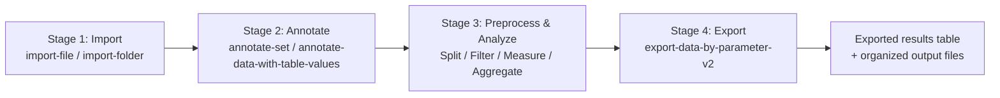

# Common JIPipe Workflow Outline

This document describes the **canonical end-to-end JIPipe workflow** for a bioimage
analysis project. Every JIPipe pipeline can be broken into four stages. Understanding
these stages and the order in which they execute is the single most important concept
for building correct, portable pipelines.

The four stages are:

1. **Find the input files** (import raw data into the pipeline)
2. **Add text annotations for data management** (label each data item with metadata)
3. **Preprocessing and analysis** (process images, measure, compute)
4. **Exporting results** (write user-controlled output files)

Each stage below describes its **Purpose**, the **Key nodes** involved (by node ID and
display name), **What to do** step-by-step, **How annotations behave** at that stage,
and **Common mistakes**.

## Mermaid Diagram of the Canonical Flow



The flow is strictly left-to-right: data flows from import, through annotation,
through analysis, into export. Annotations created in Stage 2 are **carried forward**
through every subsequent stage and ultimately drive how output files are named and
organized in Stage 4.

## Stage 1 — Find the Input Files

### Purpose

Bring raw data (images, tables, folders) from the filesystem into the JIPipe
pipeline so that downstream nodes can process it. Without this stage there is no
data to work on.

### Key nodes

| Node ID | Display name | Description |
|---------|-------------|-------------|
| `import-file` | Import file | Import a single file; outputs `FileData`. Key parameter: `file-name`. |
| `import-file-list` | Import file list | Import multiple individual files; outputs `FileData`. Key parameter: `file-names`. |
| `import-folder` | Import folder | Import a single folder; outputs `FolderData`. Key parameter: `folder-path`. |
| `import-folder-list` | Import folder list | Import multiple folders; outputs `FolderData`. Key parameter: `folder-paths`. |
| `import-path` | Import path | Import a single path; outputs `PathData` (the base path type). Key parameter: `path`. |
| `import-path-list` | Import path list | Import multiple paths; outputs `PathData`. Key parameter: `paths`. |
| `project-user-directory` | Project user directory | Resolve a named project user path (by `key`) and output `FolderData`. Throws if the key is not found. |
| `folder-list-files` | List files | List the files inside a directory with optional name filters. |

Image-specific importers (e.g. the Bio-Formats importer) live in the `jipipe-plugin-ij`
module and convert imported files/paths into image data types. They are described
separately — this stage covers the filesystem-level source nodes only.

### What to do

1. Decide where your raw data lives on disk. Prefer **project user directories** or
   the **project directory** so the workflow stays portable when the project folder
   is moved.
2. Add an `import-file` or `import-folder` node (or the `-list` variants) and point
   it at the data.
3. If your data is organized in folders per condition/replicate, use
   `import-folder-list` to bring in each folder as a separate data item.
4. (Optional) Use `project-user-directory` with a `key` like `RawData` to reference a
   configured project user path instead of hard-coding an absolute path.
5. Connect the output of the import node to Stage 2.

### How annotations behave

At this stage **no annotations exist yet**. Each imported file/folder becomes a data
item with an empty annotation set. The only intrinsic metadata is the filesystem
path.

### Common mistakes

- Using **absolute paths** that break when the project is moved to another machine.
  Always prefer project-relative or project-user-directory references.
- Importing a single folder when you actually want each file inside it as a separate
  data item. Use `folder-list-files` to expand a folder into individual files.
- Forgetting that `import-folder` outputs `FolderData`, not image data. You still
  need an image importer node to turn the folder contents into images.

## Stage 2 — Add Text Annotations for Data Management

### Purpose

Attach human-readable metadata (e.g. `Condition`, `Channel`, `Replicate`) to each
data item so that downstream nodes can split, filter, group, and name outputs
accordingly. Annotations are the backbone of JIPipe's data management model.

### Key nodes

| Node ID | Display name | Description |
|---------|-------------|-------------|
| `annotate-set` | Set/Edit annotations | Add or edit annotations using expressions. |
| `annotate-set-single` | Set single annotation | Set one annotation name/value pair. |
| `annotate-data-with-table-values` | Annotate with table values | Merge annotations from a `ResultsTableData` input into the data stream. |
| `annotation-merge` | Merge annotations | Combine annotations from two data streams. |
| `overwrite-annotations` | Overwrite annotations | Replace existing annotation values. |
| `rename-annotation` | Rename annotation | Rename an annotation key. |
| `filter-by-annotation` | Filter by annotation | Keep only data matching an annotation expression. |
| `split-by-annotation` | Split by annotation | Split data into groups based on annotation values. |
| `generate-unique-annotation` | Generate unique annotation | Create a unique identifier annotation. |
| `simplify-annotations` | Simplify annotations | Remove unused annotations. |

### What to do

1. After importing, add an `annotate-set` node. Define annotation **names** and
   **values** using expressions. For example, set `Condition` to `"Control"` for one
   import branch and `"Treated"` for another.
2. If your metadata already exists in a CSV/Excel table, use
   `annotate-data-with-table-values`: feed the Data stream and the Table stream into
   the node, and define output annotations whose value expressions reference the
   table columns (each column is exposed as an expression variable).
3. If data items come from differently named folders, you can derive annotation
   values from the folder/file name using string expression functions.
4. Ensure every data item that should be grouped together shares the same annotation
   name/value for the grouping key (e.g. all control replicates have
   `Condition=Control`).

### How annotations behave

Annotations are **created** here. They do not exist before Stage 2 and are **carried
forward** into every subsequent stage. Downstream analysis nodes preserve annotations
automatically. Export nodes in Stage 4 **consume** annotations to generate organized
output file names.

### Common mistakes

- Not annotating early enough. If you wait until after analysis, it becomes much
  harder to trace which output came from which condition.
- Using inconsistent annotation names (e.g. `condition` vs `Condition`). Annotation
  names are case-sensitive.
- Expecting annotations to automatically appear from the filesystem. You must
  explicitly create them with an annotation node.

## Stage 3 — Preprocessing and Analysis

### Purpose

Transform the annotated data: split channels, filter, preprocess images, run
measurements, and aggregate results. This is the experiment-specific core of the
pipeline.

### Key nodes

This stage uses the broadest set of nodes. Common categories include:

- **Splitting**: `split-by-annotation` (group by annotation), channel/slice splitters
  (in `jipipe-plugin-ij-algorithms`).
- **Filtering**: `filter-by-annotation` (keep data matching an expression).
- **Image preprocessing**: deconvolution, background subtraction, filtering,
  thresholding (in `jipipe-plugin-ij-algorithms`).
- **Measurement**: intensity measurements, object counting, colocalization.
- **Aggregation**: merge results tables, combine annotations via `annotation-merge`.

### What to do

1. Use `split-by-annotation` to separate data into per-condition or per-channel
   groups if your analysis differs by group.
2. Apply preprocessing nodes in the required order. Each node preserves the incoming
   annotations automatically.
3. Run measurement nodes. Measurement outputs are typically `ResultsTableData` rows,
   each still carrying the original annotations.
4. Use aggregation nodes (e.g. merge tables, combine streams) to produce a single
   results table that contains one row per data item with all annotations and all
   measured values.

### How annotations behave

Annotations are **carried forward**. Analysis nodes attach the input item's full
annotation set to each output item. When a node splits one input into multiple
outputs, all outputs inherit the same annotations. When two streams are merged,
annotations are combined according to the node's annotation-merge-mode (see the
`data-management/annotation-management` knowledge entry).

### Common mistakes

- Losing track of which output row corresponds to which input image. This happens
  when annotations are not set before analysis. Always annotate first.
- Splitting data without a clear grouping annotation, making results impossible to
  recombine meaningfully.
- Assuming analysis nodes create annotations. They do not — they only preserve them.

## Stage 4 — Exporting Results

### Purpose

Write the final processed data and result tables to user-specified locations on
disk. JIPipe automatically caches all intermediate outputs; exporter nodes exist
for **explicit, user-controlled output** of the files you actually want to keep.

### Key nodes

| Node ID | Display name | Description |
|---------|-------------|-------------|
| `export-data-by-parameter-v2` | Export data | Main expression-based exporter. Output path defined by a `DataExportExpressionParameter` (default `PATH_COMBINE(data_dir, auto_file_name)`). |
| `export-data` | Export data (path input) | Takes a `PathData` input slot named "Path" for the output directory. |
| `export-data-table` | Export data table | Export a table to CSV/TSV. |
| `export-data-table-by-parameter` | Export data table (expression) | Export a table using an expression for the output path. |

Image/table/ROI-specific exporters (Export image, Export table, Export table as
XLSX, Export ROI) live in `jipipe-plugin-ij-algorithms`. Bio-Formats exporters live
in `jipipe-plugin-ij`.

### What to do

1. Add `export-data-by-parameter-v2` at the end of each output branch.
2. Set the `file-path` expression. Use project-relative or project-user-directory
   references for portability. Recommended patterns:
   - `PATH_COMBINE(project_user_path.Results, Condition, Channel, "${File name}_result.tif")`
   - `PATH_COMBINE(project_dir, "results", auto_file_name)`
3. Let `auto_file_name` generate a filesystem-compatible name automatically from
   sorted annotation values joined by `_`. This prevents accidental overwrites and
   keeps output organized by metadata.
4. For results tables, use `export-data-table` or `export-data-table-by-parameter`.
5. (Optional) Use `get-exported-path` (`ConvertToExportedPath`) if a downstream node
   needs the filesystem path where data was exported.

### How annotations behave

Annotations are **consumed** here. Every text annotation on a data item is available
as an expression variable inside the export path expression. The `annotations` map
variable and `auto_file_name` (built from sorted annotation values) are the primary
mechanisms for generating organized, non-colliding output file names.

### Common mistakes

- Forgetting that JIPipe already caches everything. Exporter nodes are only needed
  for files you want to explicitly share or archive — do not export every
  intermediate step.
- Using absolute output paths. Prefer `project_dir` or `project_user_path.<key>`.
- Not including unique annotations in the path, causing file overwrites. Use
  `auto_file_name` or include `Condition`, `Channel`, `Replicate`, etc. in the path.

## Worked Example: 2-Condition, 2-Channel Fluorescence Experiment

### Experiment setup

- Two conditions: `Control` and `Treated`.
- Two fluorescence channels per image: `DAPI` (nuclei) and `GFP` (signal).
- Raw data: one folder per condition, each containing paired DAPI and GFP TIFF files.
- Goal: measure mean intensity per channel per condition and export a combined
  results table plus per-image processed images.

### Stage 1 — Import

1. Add `import-folder-list` pointing at the two condition folders. Output:
   `FolderData` items (one per condition).
2. Add `folder-list-files` to expand each folder into individual `FileData` items
   (the TIFF files).
3. Add an image importer (from `jipipe-plugin-ij`) to convert `FileData` into image
   data.

### Stage 2 — Annotate

1. Add `annotate-set`:
   - For the Control folder branch: `Condition = "Control"`.
   - For the Treated folder branch: `Condition = "Treated"`.
2. Add a second `annotate-set` (or use an expression derived from the file name) to
   set `Channel` to `"DAPI"` or `"GFP"` based on the filename.
3. Optionally set `Replicate` from the filename as well.

Now every image carries: `Condition`, `Channel`, `Replicate`.

### Stage 3 — Preprocess and Analyze

1. Use `split-by-annotation` on `Channel` to separate DAPI from GFP streams.
2. On the DAPI stream: threshold to find nuclei, create a mask.
3. On the GFP stream: measure mean intensity inside the DAPI mask.
4. Merge measurement tables so each row has `Condition`, `Channel`, `Replicate`,
   and `Mean intensity`.

### Stage 4 — Export

1. Add `export-data-by-parameter-v2` for the processed images:
   ```
   PATH_COMBINE(project_user_path.Results, Condition, Channel, "${File name}_processed.tif")
   ```
2. Add `export-data-table-by-parameter` for the combined results table:
   ```
   PATH_COMBINE(project_dir, "results", "summary.csv")
   ```

The result: an organized output folder structure like:

```
results/
  Control/
    DAPI/
      img1_processed.tif
    GFP/
      img1_processed.tif
  Treated/
    DAPI/
      img2_processed.tif
    GFP/
      img2_processed.tif
summary.csv
```

All driven by the annotations set in Stage 2.

## Summary

| Stage | Primary action | Annotations |
|-------|---------------|-------------|
| 1. Import | Bring raw data into the pipeline | None (empty) |
| 2. Annotate | Attach metadata labels | Created |
| 3. Analyze | Process, measure, aggregate | Carried forward |
| 4. Export | Write user-controlled output | Consumed (drive file naming) |

For deeper detail on each stage, see the cross-referenced knowledge entries on
import/annotation management, annotation management, and project organization.
